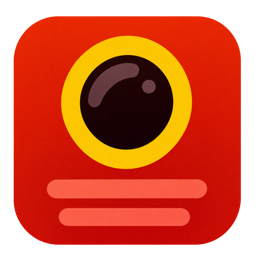

# Flicker Folio

**Version 0.8**

A free, offline teleprompter for macOS. A project by **Sagar Paperwala**.

When I record a product pitch or a video résumé, I want to talk to the camera without memorizing an entire script. A Notepad window pulls my eyes away from the lens. Flicker Folio puts the script beside the camera, so I can glance at a cue, look back at the lens, and keep talking.

| Use case | What to put in the script |
| --- | --- |
| Product pitch or roadmap update | The customer problem, the trade-off, the evidence, and the decision you want. |
| Product demo or stakeholder walkthrough | Short cues for what to show, what to explain, and when to pause. |
| Video résumé | Your introduction, two relevant outcomes, and the role you want. |
| Tutorial or video content | A short opening, talking points for each segment, and a closing line. |

## Install on your Mac

Requires **macOS 15 or later** and Apple’s **Xcode 16 or newer**, or matching Command Line Tools with Swift 6 and the macOS 15 or newer SDK. The app builds for your Mac’s architecture.

1. Run `xcode-select --install` in Terminal if you need Apple’s Command Line Tools.
2. [Download the source ZIP](https://github.com/psagar786/flicker-folio/raw/refs/heads/main/Flicker-Folio-0.8-source.zip) and extract it. Open Terminal, type `cd ` with a trailing space, drag the extracted folder into Terminal, and press Return.

3. Build and open Flicker Folio from that folder.

   ```sh
   bash ./build-local.sh
   open "dist/Flicker Folio.app"
   ```

4. To keep the app, copy it from `dist` into Applications using Finder. Quit any running Flicker Folio instance before replacing it. The bundle identity is retained so upgrades can use existing scripts and settings.

The build script ad-hoc signs the local app. This is a source distribution without Developer ID notarization. Downloading the source and tools requires internet access. The app runs offline after setup. macOS may need to provision the selected on-device speech language first.

## Develop and contribute

Fork the repository on GitHub, then clone your fork. To try the code first, clone the public repository below.

```sh
git clone https://github.com/psagar786/flicker-folio.git
cd flicker-folio
bash ./build-local.sh
open "dist/Flicker Folio.app"
```

- [NotchPrompter](NotchPrompter/) contains the macOS app, including the notes editor, prompter, and recording controls.
- [NotchPrompterKit](NotchPrompterKit/) contains voice matching, speech recognition, note formatting, and script storage.
- [Tools](Tools/) contains the local regression tests. Run the speech matcher with `zsh Tools/test-matcher.sh`.

Create a branch for your change and run the build before opening a pull request. Describe what changed and how you tested it. For pacing or speech changes, include the mode, WPM, recognition language, and a short fictional script so others can reproduce the behavior.

## Start reading

1. Open **Start Here · Flicker Folio** in the library, or reopen it from **Help → Open Starter Script**. The **Practice** folder also includes product pitch and video résumé scripts.
2. Write or paste a script into **Script**. **Import** accepts plain text, Markdown, Word, RTF, and HTML. The editor keeps supported inline formatting and exports plain text or Markdown. Use **Private Notes** for reminders you want off the prompter and out of exports.
3. Open the prompter from the macOS menu bar. Use the gear for pacing, WPM, text size, font, color, and width. Start at 140 WPM and adjust during a take. The notes toolbar also has a WPM control.
4. Start playback or speech follow. Scroll with the mouse or trackpad. Click inside the prompter for keyboard focus. Use **↑/↓** to move, **Space** to pause or resume, **Shift + ↑/↓** to change WPM, **R** to restart, and **S** to search and switch scripts. A switched script starts at the top.
5. Press **C** or use the record button to start or stop a take. The optional 3–2–1 countdown has a separate sound setting. Watch for the listening microphone or the **REC** timer. Find takes in `~/Movies/Flicker Folio`. Older takes may still be in `~/Movies/NotchPick`.

| Mode | How it moves |
| --- | --- |
| **Timed** | Scrolls at your chosen words per minute. Speed changes ease in while you read. |
| **Conversational** | Scrolls at your WPM when the mic detects speech, holds through brief gaps, and eases to a stop when you pause. It uses sound level, so adjust microphone sensitivity for your room. |
| **Follow My Words** | Matches spoken words to nearby script cues, skips blank lines, and glides towards the latest matched line. If you paraphrase, say a distinctive word from the next line or click a word to set your place. |
| **Sentence by Sentence** | Gives each sentence or readable section a pause based on WPM, then advances. |

**English (India)** is the default voice language. Use **More Settings → Test My Voice** to check which words your Mac recognizes. If the local model is unavailable, enable **Dictation** under **System Settings → Keyboard**, or use Conversational, Timed, or manual scrolling.

## Permissions and privacy

| macOS permission | When Flicker Folio uses it |
| --- | --- |
| Microphone | Conversational, Follow My Words, the mic test, and recording your voice. |
| Speech Recognition | Follow My Words, Test My Voice, and optional on-device subtitles. |
| Camera | Camera preview or video recording from a camera. |
| Screen & System Audio Recording | Screen capture, including the screen half of a combined take. |
| File or folder access | macOS may ask when you import, export, select a script folder, or save where system privacy controls apply. |

Manual scrolling and Timed reading work without microphone, speech, camera, or screen-recording access. **Flicker Folio collects no user data.** It has no accounts, backend, advertising, analytics, or cloud speech fallback. Scripts, preferences, and takes stay on your Mac. See the [privacy note](PRIVACY.md) for storage locations, local subtitles, and what happens when you choose a synced folder.

## Report a bug or suggest an improvement

[Open a GitHub issue](https://github.com/psagar786/flicker-folio/issues/new/choose). Include your Flicker Folio and macOS versions, Mac model, steps to reproduce, and what happened. For pacing, include the mode, WPM, and input method. For speech, include the recognition language and microphone type. Use a short fictional script and leave out personal notes, audio, and identifying screenshots. GitHub issues are public.

## Tools and credits

Built with Swift, SwiftUI and AppKit. Apple Speech handles on-device recognition, AVFoundation and Core Audio handle camera and microphone work, ScreenCaptureKit handles screen capture, and Carbon registers optional keyboard shortcuts. Foundation and UniformTypeIdentifiers support local storage and import. The build uses Apple’s `swiftc` and `codesign`. There are no third-party runtime packages or hosted services. The repo includes local pacing, matching, and notes regression tests.

Flicker Folio is free to use and available under the [MIT License](LICENSE). It adapts [NotchPrompter](https://github.com/magnram/notchprompter/tree/9196c3659ac4eec025139d06250c9a0f27b8be15) by Magnus Ramm. The upstream copyright and license are included. Flicker Folio project and product direction by **Sagar Paperwala**.
